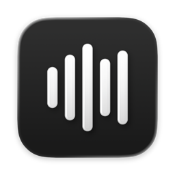
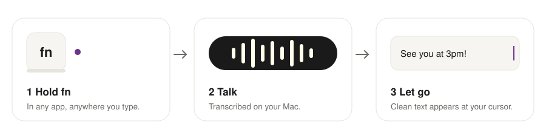

<!-- prettier-ignore -->
<div align="center">



# Free Flow

**Voice to text for your Mac.** Hold **fn**, talk, let go, and clean text appears wherever you're typing.

<a href="https://github.com/jng011/freeflow/releases/latest">
  <picture>
    <source media="(prefers-color-scheme: dark)" srcset="./docs/images/download-dark.svg">
    
  </picture>
</a>

macOS 26+ &nbsp;·&nbsp; Apple Silicon &nbsp;·&nbsp; Free and open source

[Why](#why-free-flow) • [Features](#features) • [How it works](#how-it-works) • [Install](#installation) • [Shortcuts](#shortcuts) • [AI agents](#let-ai-agents-see-your-dictations) • [Build from source](#build-from-source)

</div>

<!-- screenshot: Flow Bar while dictating -->

Free Flow turns your voice into polished text in any app. Speech is transcribed on your Mac with Whisper, Parakeet or Apple Speech, then optionally tidied up by AI so filler words, false starts and missing punctuation never reach the page. No account needed.

> [!TIP]
> Free Flow reads the **fn** key straight from the keyboard, so even quick double taps are caught reliably. Nothing to configure: just hold fn and talk.

## Why Free Flow

- **Instant.** Hold a key and talk. No window to open, no button to click.
- **Private.** Your speech is transcribed on your Mac.
- **Agent-native.** A built-in MCP server lets AI agents work with your dictations.
- **Open.** Free, GPL v3, written in Swift. No account.

## Features

- **Hold fn to talk.** Double tap fn for hands-free, tap again to stop.
- **Cleans up as you go.** Filler words, false starts and punctuation are fixed before the text is pasted. Add an OpenRouter, Anthropic or OpenAI key in **Settings > AI Cleanup**, or use Apple Intelligence on-device where available.
- **"Scratch that."** Say it and the last thing you said is taken back.
- **Prompt mode.** Hold **Ctrl** with **fn** and a rambling request comes out as a clear prompt for an AI assistant.
- **Ask Siri.** Start with "Ask Siri" and your words go straight to Siri.
- **Only your voice.** Free Flow can learn your voice and leave out other people talking nearby (**Settings > General > Voice**).
- **Runs on your Mac.** Transcription uses Whisper, Parakeet or Apple Speech locally.
- **Dictionary.** Teach it names and jargon once and it spells them your way.
- **Files.** Drop in a voice memo, meeting or video (MP3, M4A, WAV, MP4, MOV and more) to get a clean transcript.
- **Insights.** Words per minute, streaks, and where you dictate most.
- **AI agent access.** A local MCP server lets agents like Claude read your history and stats, manage your dictionary and transcribe files.

## How it works

<p align="center">
  <picture>
    <source media="(prefers-color-scheme: dark)" srcset="./docs/images/how-it-works-dark.svg">
    
  </picture>
</p>

1. **Hold fn** in any app and start talking. The Flow Bar shows that Free Flow is listening.
2. **Let go.** Your audio is transcribed on your Mac.
3. **Cleanup runs.** Your dictionary spellings are applied and, if enabled, AI cleanup fixes fillers, false starts and punctuation.
4. **Text appears** at your cursor, ready to send.

<!-- screenshot: Home history feed -->

## Requirements

| | |
|---|---|
| **macOS** | 26 or later |
| **Chip** | Apple Silicon (M1 or newer). Intel Macs aren't supported. |
| **Permissions** | Microphone, Accessibility, Input Monitoring |

## Installation

1. Download **`Free-Flow-<version>.dmg`** from the [latest release](https://github.com/jng011/freeflow/releases/latest).
2. Open it and drag **Free Flow** to **Applications**.
3. Open Free Flow and follow the setup. It asks for:
   - **Microphone:** only used while you dictate.
   - **Accessibility:** to paste into the app you're using.
   - **Input Monitoring:** to read the fn key directly from the keyboard.

> [!NOTE]
> The app is signed and notarized by Apple, so it opens without security warnings.

### Updates

Free Flow updates itself with [Sparkle](https://sparkle-project.org), installing new versions from this repository's [releases](https://github.com/jng011/freeflow/releases).

## Shortcuts

| Action | Shortcut |
|---|---|
| Dictate | Hold **fn**, release to finish |
| Hands-free | Double tap **fn**, tap again to stop |
| Prompt mode | Hold **Ctrl** + **fn** |
| Take back the last thing you said | Say "scratch that" |
| Send to Siri | Start with "Ask Siri" |

## Let AI agents see your dictations

Free Flow includes a local MCP server, so agents like Claude can:

- Read and search your dictation history
- See your stats
- Read your dictionary and add words
- Transcribe audio files through the app

Open Free Flow once, then run:

```sh
claude mcp add free-flow -- python3 "$HOME/Library/Application Support/com.jaydenghiyam.FreeFlow/freeflow_mcp.py"
```

> [!IMPORTANT]
> The server runs on your Mac. Nothing leaves it unless the agent sends it.

The same command is shown during onboarding and in **Settings > Data and Privacy**.

## Build from source

### Prerequisites

- macOS 26 on Apple Silicon
- Xcode 26 with command line tools (`xcode-select --install`)
- CMake (`brew install cmake`), to build whisper.cpp

### Steps

```sh
# 1. Clone
git clone https://github.com/jng011/freeflow.git
cd freeflow

# 2. Build whisper.cpp as an xcframework into Vendor/
git clone --depth 1 https://github.com/ggml-org/whisper.cpp.git /tmp/whisper.cpp
(cd /tmp/whisper.cpp && ./build-xcframework.sh)
mkdir -p Vendor && cp -R /tmp/whisper.cpp/build-apple/whisper.xcframework Vendor/

# 3. Open in Xcode and run the FreeFlow scheme
open FreeFlow.xcodeproj
```

In Xcode, choose your own team under **Signing & Capabilities**, then press **Run** (Cmd+R).

> [!TIP]
> To build a signed Release copy or a notarized DMG from the command line, see [BUILDING.md](BUILDING.md). Swift packages built from source live in `Packages/`.

## Acknowledgments

Free Flow stands on these open-source projects:

**Speech**
- [whisper.cpp](https://github.com/ggml-org/whisper.cpp): fast on-device Whisper, with the Silero voice activity model
- [FluidAudio](https://github.com/FluidInference/FluidAudio): Parakeet transcription and the speaker embeddings behind "Only your voice"

**App**
- [Sparkle](https://github.com/sparkle-project/Sparkle): automatic updates
- [MarkdownUI](https://github.com/gonzalezreal/swift-markdown-ui): rendering formatted text
- [SelectedTextKit](https://github.com/tisfeng/SelectedTextKit), with [AXSwift](https://github.com/tisfeng/AXSwift) and [KeySender](https://github.com/jordanbaird/KeySender): reading the text around your cursor
- MediaRemoteAdapter: pausing music while you dictate, bundled in `Packages/`
- [Zip](https://github.com/marmelroy/Zip): import and export
- [Swift Atomics](https://github.com/apple/swift-atomics): low-level thread safety
- LLMkit: the AI provider client, bundled in `Packages/`

**Fonts**
- [Figtree](https://github.com/erikdkennedy/figtree) and [EB Garamond](https://github.com/octaviopardo/EBGaramond12), under the SIL Open Font License

Portions of Free Flow are derived, with modifications, from VoiceInk (GPL v3).
